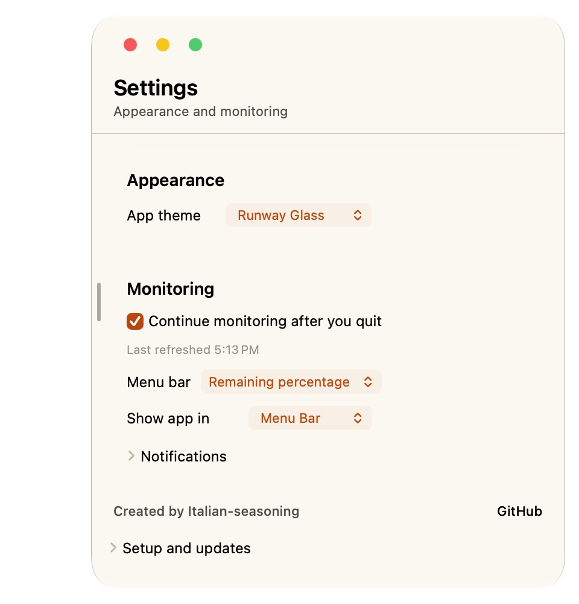
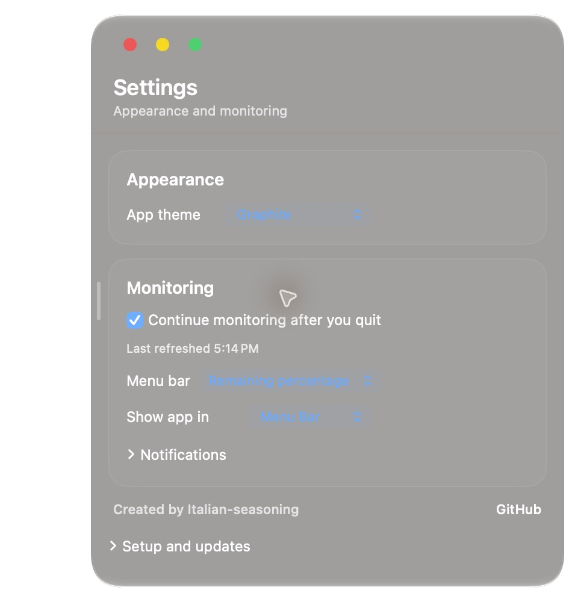

# Runway

<p align="center">
  
</p>

[View the software showcase](https://italian-seasoning.github.io/CodexUsageMonitor/)

**Runway — Codex usage at a glance**

A native macOS app and WidgetKit extension for local Codex usage, model-aware
API-equivalent cost estimates, Headroom savings, and configurable desktop widgets.

Previously named **Codex Usage Monitor**. The local project, Xcode targets, installed
app, and data folders are named **Runway**. The old project and app paths remain
compatibility aliases for older documents. Historical bundle identifiers, settings
keys, widget kinds, and published download URLs remain compatible with existing
installs. The Homebrew cask is `runway`.

**Created by [Italian-seasoning](https://github.com/Italian-seasoning).**
Original project: [Italian-seasoning/CodexUsageMonitor](https://github.com/Italian-seasoning/CodexUsageMonitor).

## Quick install

```sh
brew install --cask italian-seasoning/tap/runway
```

Current preview: **4.0.3**. [Download the DMG](https://github.com/Italian-seasoning/CodexUsageMonitor/releases/download/v4.0.3/CodexUsageMonitor-macOS.dmg).

Requires macOS 14 or newer on Apple silicon or Intel.

These previews are not Apple-notarized. Homebrew verifies the archive checksum and leaves Gatekeeper enabled. If macOS blocks the first launch, review the app in **System Settings → Privacy & Security**. Sparkle verifies subsequent in-app updates with its signed feed.

## See the app





Screenshots show local preview builds. Empty queues and standby states are shown where applicable.


## Forks and attribution

If you fork, redesign, redistribute, or build on this project, please keep the
original creator credit visible in your README and app credits, with a link to
this repository. Identify your changes and your own maintainers separately;
please do not present a derivative as the original project or imply endorsement.

Copy this into your README and adapt the final sentence:

> Based on **Runway**, created by
> [Italian-seasoning](https://github.com/Italian-seasoning).
> Original source: [Italian-seasoning/CodexUsageMonitor](https://github.com/Italian-seasoning/CodexUsageMonitor).
> This fork is independently maintained; its changes are described below.

See [CREDITS.md](CREDITS.md) for attribution guidance. These credit requests do
not replace a software license or third-party license notices.

## v4 source preview

- Apple Liquid Glass workspace on macOS 26+, with a material fallback on older systems
- Cursor-driven sidebar reveal, threshold haptics, trackpad gestures, and hover navigation
- Clearer charts with exact values on hover and custom date ranges
- Remaining allowance and estimated percentage-point consumption per 15 minutes
- Account-window accuracy fixes, archived-session history, and improved widget synchronization

The source on `main` is the v4 preview. WidgetKit controls when desktop widgets redraw;
rate estimates appear only when enough recent observations are available.

> [!WARNING]
> **Preview software.** The current build is not signed with an Apple Developer ID
> or notarized by Apple. macOS may require Control-clicking the app and choosing
> **Open**. Treat it as a test build, not a finished production release.

[Download the unsigned preview](https://github.com/Italian-seasoning/CodexUsageMonitor/releases/latest/download/CodexUsageMonitor-macOS.dmg)
· [View the website](https://italian-seasoning.github.io/CodexUsageMonitor/)
· [Report an issue](https://github.com/Italian-seasoning/CodexUsageMonitor/issues)

## What it tracks

**Windows and Linux:** [Simple Windows desktop and Linux ASCII clients](portable/README.md)
are available in the release downloads. The native macOS app retains the full widget and glass experience.

- Local session and model breakdowns; account daily and lifetime token totals for Trends and token widgets when the Codex CLI is available
- Input, cached input, output, and reasoning tokens
- Requests, sessions, streaks, context use, and visible chart peaks
- Recorded models and API-equivalent cost estimates by model
- Top model today, seven days, this month, and lifetime
- Headroom tokens saved, savings rate, and estimated cost avoided
- Live account five-hour and weekly Codex limits, reset times, pace, and local seven-day history
- A native menu bar meter with percentage, meter, and reset-countdown modes
- Background widget snapshots every minute while the app is closed
- Independent settings for small, medium, and large widgets

## Privacy

Runway reads local Codex logs and the local Headroom database. When
the Codex CLI or ChatGPT desktop app is installed, it also asks Codex's
app-server for account daily usage, lifetime totals, and current limits. The app-server may
contact OpenAI using your existing sign-in. The monitor does not upload prompts,
responses, or local session history. GitHub is
used only for optional Sparkle updates. See the full [privacy policy](docs/privacy.html).

## Requirements

- macOS 14 or later
- Apple silicon or Intel Mac
- Codex local session logs in `~/.codex/sessions`
- ChatGPT desktop app or Codex CLI signed in to the same account for profile lifetime totals and live limits; otherwise local estimates are shown
- Headroom is optional: it is a local proxy that compresses context before requests reach a model; Runway reads its local savings records

## Build

Open `Runway.xcodeproj` in Xcode and run the
`Runway` scheme. Sparkle resolves through Swift Package Manager.

Release packaging and GitHub publishing are documented in
[`DISTRIBUTION.md`](DISTRIBUTION.md).

## Version

Latest published Mac preview: **4.0.3**. Windows and Linux clients: **4.0.1**.

Includes GPT-6.1 Sol usage and API-equivalent cost estimates.
Streams session and Headroom logs to reduce refresh memory use on large histories.

Runway is independent software and is not affiliated with OpenAI.

## License and attribution

[MIT](LICENSE) — Copyright © 2026 [Italian-seasoning](https://github.com/Italian-seasoning). Forks and redistribution are allowed; retain the copyright and license notice. Please identify independently maintained forks and link back to this project. Third-party components retain their own licenses.
